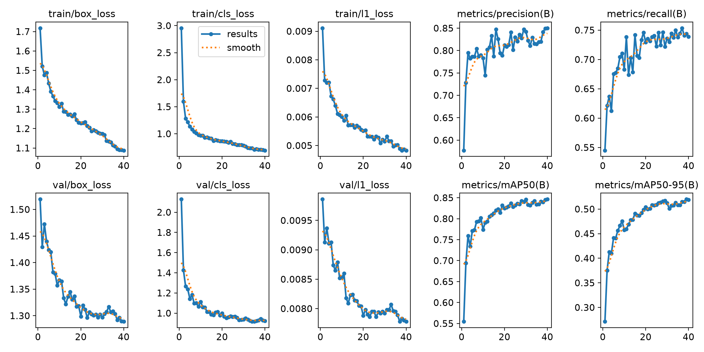
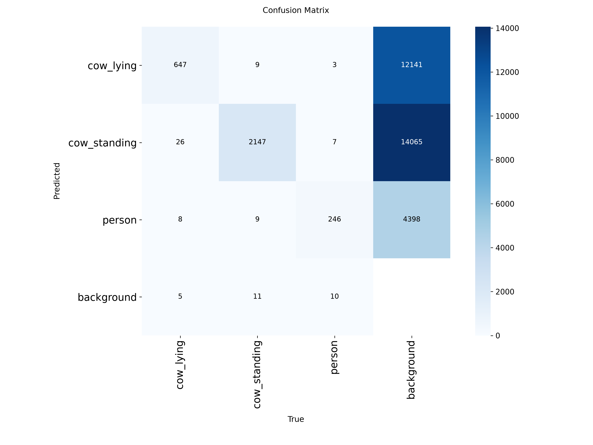
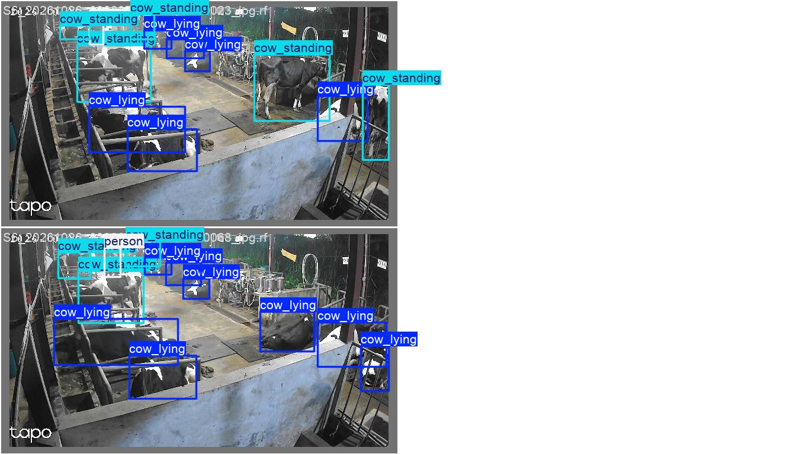
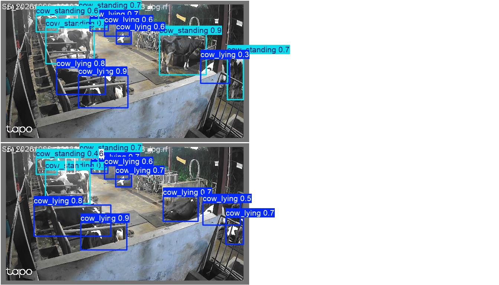

# Machine Learning SmartCow YOLO26n

Deteksi postur sapi perah dan orang pada rekaman CCTV kandang memakai YOLO26n. Tiga kelas: `cow_standing`, `cow_lying`, dan `person`. Repositori berisi kode training, bobot hasil training, grafik, dan contoh keluaran.

## Ringkasan

| Item | Nilai |
|---|---|
| Tugas | Deteksi objek 3 kelas |
| Model | Ultralytics YOLO26n (pretrained COCO), fine-tuning di CPU |
| Data | 999 frame: 599 train, 152 val, 248 test |
| Konfigurasi | 640 px, batch 2, 40 epoch, patience 10, seed 0, 6 thread |
| Waktu training | sekitar 1 jam 31 menit di CPU |
| mAP50 test | 0.858 (mAP50-95 0.551) |

## Peran teknis

OpenCV dipakai untuk ekstraksi frame dan penyaringan kualitas (kecerahan, kontras, ketajaman, area kandang). Roboflow dipakai untuk auto-label dan ekspor format YOLO26. Training dan evaluasi memakai Ultralytics YOLO26n dengan PyTorch di CPU, tanpa cloud dan tanpa model lain.

## Dataset

Sumbernya 55 rekaman CCTV Tapo 1920x1080, 15 fps, total sekitar 25,5 jam. Frame diambil setiap 15 detik dengan filter kualitas dan jarak minimum antar-frame; dari 3.742 kandidat terpilih 999 frame. Split dilakukan per sesi rekaman agar satu video tidak muncul di dua split:

| Split | Frame | Sesi |
|---|---:|---|
| train | 599 | S3 |
| val | 152 | S1 (120) + S2 (32) |
| test | 248 | S6 |

Sesi S4 dan S5 tidak dipakai karena sudah pernah dipakai pada evaluasi versi sebelumnya. Label berasal dari auto-label Roboflow untuk 999 frame tersebut: sekitar 9.061 kotak `cow_standing`, 2.612 `cow_lying`, dan 1.180 `person`. Tidak ada augmentasi saat ekspor, hanya auto-orient.

Label ini adalah **label acuan otomatis**, bukan anotasi manual atau ground truth manusia. Dataset penuh dan video sumber tidak disertakan.

## Training

```bash
python -m venv .venv
.venv\Scripts\activate
pip install -r requirements.txt
python train.py
```

`train.py` memakai `data.yaml` dan mengunduh bobot awal `yolo26n.pt` bila belum ada. Dataset diharapkan berada di `data/images/{train,valid,test}` dengan label di `data/labels/{train,valid,test}`. Untuk lokasi lain, arahkan `--data` ke file YAML dengan struktur yang sama.

Konfigurasi yang dipakai: CPU, 640 px, batch 2, 40 epoch, patience 10, seed 0, 6 thread, `workers 0`. Argumen lain tersedia lewat `python train.py --help`.

Inferensi dengan bobot yang disertakan:

```bash
yolo predict model=weights/yolo26n_640_s0_best.pt source=data/images/test imgsz=640 conf=0.25 device=cpu
```

## Hasil

| Split | mAP50 | mAP50-95 |
|---|---:|---:|
| val | 0.845 | 0.520 |
| test | 0.858 | 0.551 |

P/R/F1 per kelas pada test, operating point `conf 0.25`, NMS IoU 0.5, match IoU 0.5:

| Kelas | Precision | Recall | F1 | AP50 |
|---|---:|---:|---:|---:|
| cow_lying | 0.855 | 0.742 | 0.795 | 0.843 |
| cow_standing | 0.936 | 0.889 | 0.912 | 0.952 |
| person | 0.756 | 0.711 | 0.733 | 0.779 |
| micro | 0.904 | 0.841 | 0.872 | 0.858 |

mAP dihitung pada `conf 0.001`; micro adalah gabungan TP/FP/FN ketiga kelas, sedangkan AP50/AP50-95 micro sama dengan mAP split. Angka lengkap ada di `results/eval_metrics.json` dan `results/eval_metrics.csv`.

Angka di atas mengukur kesesuaian model dengan label acuan otomatis Roboflow, bukan akurasi di lapangan.

| Grafik training | Kurva F1 |
|---|---|
|  |  |

Matriks konfusi test pada `conf 0.25`: 

## Contoh keluaran

Dua frame test yang sama, label acuan otomatis di kiri dan prediksi model di kanan. Gambar berasal dari plot validasi Ultralytics; tiap panel berisi dua frame dan teks label dapat bertumpuk.

| Label acuan otomatis | Prediksi model |
|---|---|
|  |  |

Prediksi satu frame 1920x1080 dari sesi S6 (test), memakai bobot yang disertakan pada `conf 0.25`. Kotak dan skor ditampilkan apa adanya.


Tidak ada wajah pekerja yang dapat dikenali pada contoh yang dipilih, dan kotak maupun skor tidak diubah. Video sumber tidak disertakan.

## Batas

- Tidak ada ground truth manusia; seluruh metrik adalah kesesuaian dengan pseudo-label Roboflow.
- Tidak ada identitas sapi individual, pelacakan antar-frame, atau validasi durasi berbaring.
- Satu lokasi dan satu jenis kamera; pergeseran domain belum diuji.
- Kelas `person` ikut dilatih tetapi bukan fokus, dan performanya paling rendah.
- Hasil ini bukan klaim kesiapan produksi.

## Lisensi dan atribusi

Kode dan bobot di repositori ini dilisensikan AGPL-3.0 (lihat `LICENSE`) karena diturunkan dari Ultralytics YOLO26 yang berlisensi AGPL-3.0. Pemakaian komersial tanpa kewajiban AGPL memerlukan lisensi dari Ultralytics. Label dibuat dengan Roboflow; tidak ada klaim lisensi atas dataset, dan dataset maupun video sumber tidak didistribusikan.

SHA256 bobot: `0147ac72a1732653133f2fc47fe901f8bea29a116334e0ecfc4514315454cde5`.
