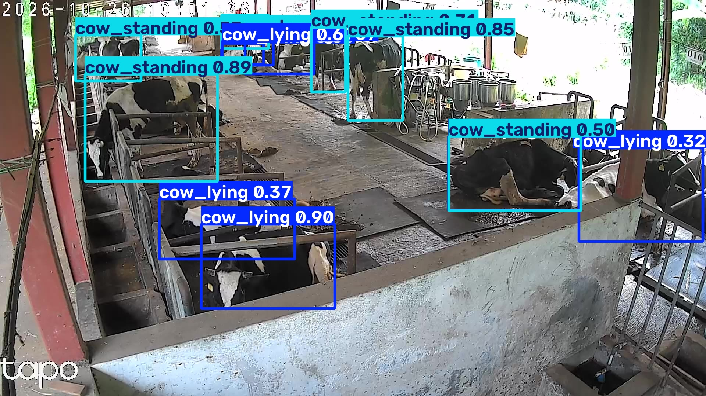
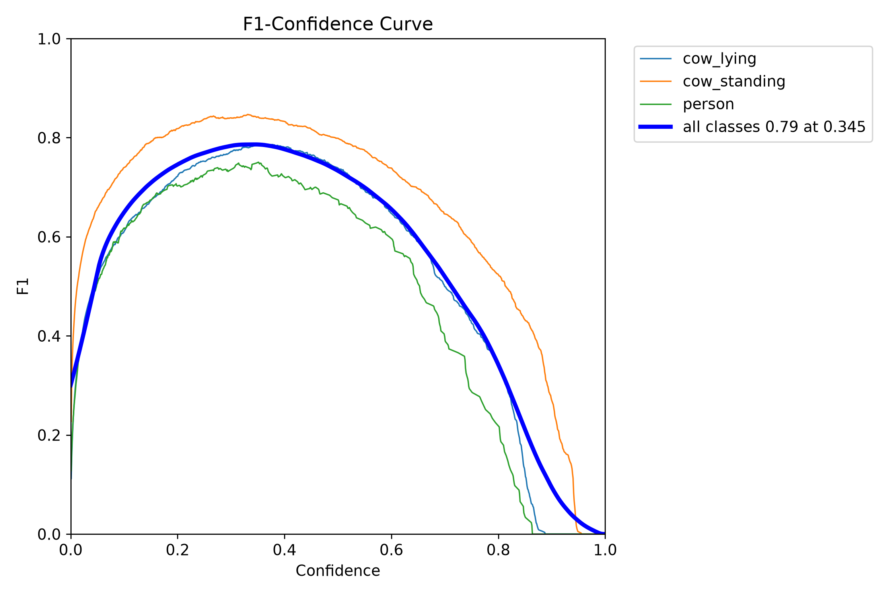

# COSTMOSYS: Deteksi Postur Sapi dengan YOLO26n

COSTMOSYS (Cow Stress Monitoring System) menggunakan rekaman CCTV untuk mengenali sapi berdiri, sapi berbaring, dan orang di kandang. Model yang digunakan adalah YOLO26n, dilatih ulang dengan gambar dari kamera kandang agar sesuai dengan sudut pandang dan kondisi pencahayaan di lokasi.

Repositori ini memuat kode training, bobot model, hasil evaluasi, dan beberapa contoh prediksi. Pengembangannya mencakup pemilihan frame dari video, pelabelan objek, pembagian data berdasarkan sesi rekaman, hingga fine-tuning dan evaluasi model. Training dilakukan di CPU menggunakan Ultralytics dan PyTorch.

## Contoh hasil deteksi

Berikut prediksi pada satu frame beresolusi 1920x1080 dari sesi S6, yang masuk ke data test. Gambar diproses dengan bobot dalam repositori ini pada `conf 0.25`; kotak dan confidence ditampilkan tanpa perubahan.



Untuk membedakan label dataset dari keluaran model, pasangan gambar berikut menampilkan frame yang sama. Sebelah kiri adalah label acuan otomatis dari Roboflow; sebelah kanan adalah prediksi YOLO26n. Setiap panel berisi dua frame dari plot evaluasi Ultralytics. Pada area yang padat, teks label dapat bertumpuk.

| Label acuan otomatis | Prediksi YOLO26n |
|---|---|
|  |  |

Contoh yang dipilih tidak menampilkan wajah pekerja yang dapat dikenali. Dataset penuh dan video sumber tidak dibagikan di repositori ini.

## Data dan proses training

Data bersumber dari 55 rekaman CCTV Tapo dengan resolusi 1920x1080 dan frame rate 15 fps, berdurasi total sekitar 25,5 jam. OpenCV digunakan untuk mengambil kandidat frame setiap 15 detik. Kandidat kemudian disaring berdasarkan pencahayaan, kontras, ketajaman pada area kandang, serta jarak waktu antar-frame untuk mengurangi gambar yang hampir sama. Dari 3.742 kandidat, terpilih 999 gambar.

Pembagian data mengikuti sesi rekaman, bukan mengacak seluruh gambar. Dengan cara ini, frame dari satu video tidak tersebar ke training dan evaluasi sekaligus.

| Pembagian | Jumlah gambar | Sesi rekaman |
|---|---:|---|
| Training | 599 | S3 |
| Validasi | 152 | S1 (120) dan S2 (32) |
| Test | 248 | S6 |

Sesi S4 dan S5 tidak dimasukkan karena sudah digunakan dalam evaluasi versi sebelumnya. Pelabelan dilakukan melalui Roboflow Auto Label untuk tiga kelas: `cow_standing`, `cow_lying`, dan `person`. Hasil pelabelan awal mencakup sekitar 9.061 kotak sapi berdiri, 2.612 kotak sapi berbaring, dan 1.180 kotak orang. Dataset diekspor ke format YOLO26 dengan auto-orient, tanpa augmentasi pada tahap ekspor.

Training dimulai dari bobot pretrained COCO `yolo26n.pt`, bukan dari bobot acak. Model kemudian di-fine-tune selama 40 epoch dengan ukuran input 640, batch 2, patience 10, dan seed 0. Proses berjalan secara lokal tanpa GPU atau layanan cloud training, menggunakan 6 thread CPU dan `workers 0`, dengan waktu sekitar 1 jam 31 menit. Roboflow digunakan untuk pelabelan dan pengelolaan dataset, sedangkan training dan evaluasi dijalankan melalui Ultralytics dan PyTorch.

## Hasil evaluasi

Pada data test, model memperoleh mAP50 sebesar 0.858 dan mAP50-95 sebesar 0.551. Deteksi sapi berdiri memberikan hasil tertinggi di antara ketiga kelas. Kelas orang masih memiliki performa terendah, meskipun ikut dilatih sebagai bagian dari deteksi di kandang.

| Pembagian | mAP50 | mAP50-95 |
|---|---:|---:|
| Validasi | 0.845 | 0.520 |
| Test | 0.858 | 0.551 |

Precision, recall, dan F1 di bawah dihitung pada data test dengan confidence 0.25, NMS IoU 0.5, dan pencocokan kotak pada IoU 0.5. Baris micro menggabungkan TP, FP, dan FN ketiga kelas; nilai AP50 per kelas berasal dari evaluasi kurva, bukan hanya titik confidence tersebut.

| Kelas | Precision | Recall | F1 | AP50 |
|---|---:|---:|---:|---:|
| cow_lying | 0.855 | 0.742 | 0.795 | 0.843 |
| cow_standing | 0.936 | 0.889 | 0.912 | 0.952 |
| person | 0.756 | 0.711 | 0.733 | 0.779 |
| Gabungan (micro) | 0.904 | 0.841 | 0.872 | - |

mAP dihitung dengan batas confidence awal 0.001. Rincian pengaturan dan angka lengkap tersedia di [eval_metrics.json](results/eval_metrics.json) dan [eval_metrics.csv](results/eval_metrics.csv).

Label evaluasi berasal dari pelabelan otomatis Roboflow dan belum diverifikasi manusia secara menyeluruh. Karena itu, skor ini menunjukkan kesesuaian terhadap label dataset, bukan persentase akurasi operasional di kandang.

| Perkembangan training | Kurva F1 |
|---|---|
|  |  |

Matriks konfusi pada data test dengan confidence 0.25:


## Menjalankan model

Siapkan lingkungan Python dan pasang dependensi sebelum menjalankan training:

```bash
python -m venv .venv
.venv\Scripts\activate
pip install -r requirements.txt
python train.py
```

Perintah aktivasi di atas untuk Windows. Dataset perlu disiapkan terlebih dahulu karena tidak disertakan di repositori. Secara default, `data.yaml` menunjuk gambar di `data/images/{train,valid,test}` dan label di `data/labels/{train,valid,test}`. Jika memakai lokasi lain, berikan file YAML melalui argumen `--data`. Bobot awal `yolo26n.pt` akan diunduh jika belum tersedia.

Pengaturan bawaan mengikuti konfigurasi training yang dijelaskan di atas. Pilihan argumen dapat dilihat melalui `python train.py --help`.

Untuk inferensi, gunakan bobot hasil training yang sudah disertakan:

```bash
yolo predict model=weights/yolo26n_640_s0_best.pt source=data/images/test imgsz=640 conf=0.25 device=cpu
```

## Cakupan penggunaan

Model ini mendeteksi objek dan postur pada gambar. Model belum mencakup identifikasi sapi individual, pelacakan antar-frame, atau pengukuran durasi berbaring yang tervalidasi. Data juga berasal dari satu lokasi dan satu jenis kamera, sehingga hasilnya belum dapat digeneralisasikan ke kandang dengan sudut kamera atau kondisi berbeda.

Hasil yang tersedia menjadi dasar untuk pengujian lapangan lebih lanjut, bukan pernyataan bahwa sistem sudah siap beroperasi tanpa pengawasan. Verifikasi label oleh manusia dan evaluasi pada kondisi pemasangan tetap diperlukan sebelum hasilnya digunakan sebagai data operasional.

## Lisensi

Kode dan bobot menggunakan lisensi AGPL-3.0, mengikuti Ultralytics YOLO26 yang menjadi dasar model ini. Ketentuannya tersedia di [LICENSE](LICENSE). Untuk penggunaan komersial yang tidak mengikuti kewajiban AGPL, diperlukan lisensi dari Ultralytics. Pelabelan menggunakan Roboflow; repositori ini tidak memberikan lisensi atas dataset atau rekaman sumber.

SHA256 bobot: `0147ac72a1732653133f2fc47fe901f8bea29a116334e0ecfc4514315454cde5`.
